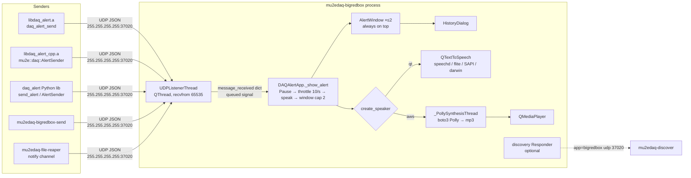

# mu2edaq-bigredbox

> Deliberately un-ignorable critical-alert annunciator that listens for JSON
> alerts on UDP broadcast port 37020 and raises an always-on-top PyQt6 window
> that also reads the alert aloud, with C, C++ and Python sender libraries.

| | |
|---|---|
| Repository | `Mu2e/mu2edaq-bigredbox` |
| Language | Python 3.9+ / PyQt6 (listener); C99, C++17, Python (sender libraries) |
| Ports | 37020/udp (alert ingest, broadcast or unicast) |
| Depends on | PyQt6 (QtWidgets, QtMultimedia, QtTextToSpeech), PyYAML; optional `mu2edaq-discovery`, optional boto3 (AWS Polly) |
| Known callers | `mu2edaq-file-reaper` notification channel `bigredbox` (default off, `critical` only; `mu2edaq-file-reaper/config/mu2edaq-file-reaper.yaml:148-151`) |
| Tests | 110 pytest cases (3 modules); no CI |
| Version | 2.0.0 (`src/mu2edaq_bigredbox/__init__.py:13`); sender libraries 1.0.0 |

Companion documents: [INTERFACES.md](INTERFACES.md) (wire format, the three
sender APIs, byte-level comparison), [OPERATIONS.md](OPERATIONS.md) (start/stop,
display, speech, failure modes), [ISSUES-PENDING.md](ISSUES-PENDING.md).

## Purpose

The Big Red Box is the control room's last-resort annunciator, modelled on
Peter Shanahan's original. Any DAQ process that hits a condition a human must
see sends one UDP datagram; a listener running on a control-room display raises
a large red always-on-top window and speaks the alert. Senders need no
knowledge of where listeners run: the default destination is the limited
broadcast address `255.255.255.255:37020`.

It is not full-screen. The window is a fixed-style 860×530 minimum, centred,
`WindowStaysOnTopHint` (`src/mu2edaq_bigredbox/daq_alert.py:286-288`), and at
most two are open at once (`config.py:125`); further alerts update the newest
window in place.

## Architecture

Threads: the Qt GUI thread (event loop, all widgets, `QTextToSpeech`,
`QMediaPlayer`); `UDPListenerThread` (blocking `recvfrom` with 1 s timeout,
emits a `pyqtSignal(dict)` that Qt queues onto the GUI thread); with the AWS
backend, `_PollySynthesisThread` (blocking `synthesize_speech`, emits audio
bytes back to the GUI thread); and the discovery responder's own thread. No
widget is touched off the GUI thread.

## Components

### `config.py` — environment-only configuration

Every knob is an environment variable parsed by a never-raise helper
(`_port`, `_path`, `_bool`, `_float`, `_choice`, `config.py:20-106`): a bad
value falls back to the default with a warning, because the module is imported
before logging is configured. `MESSAGE_RATE_LIMIT = 10.0` and
`MAX_ALERT_WINDOWS = 2` are constants, not configurable (`config.py:119,125`).
There is no command-line option and no YAML for the listener itself; the only
file is the TTS template map.

### `UDPListenerThread` (`daq_alert.py:134-200`)

Creates an `AF_INET` datagram socket with `SO_REUSEADDR` and `SO_BROADCAST`
and binds `("", port)` **in the constructor**, so a bind error surfaces on the
calling thread (`:150-158`) and `DAQAlertApp` exits with status 3 (`:614-624`).
`run()` decodes UTF-8 JSON, drops anything that is not a JSON object
(`:176-179`), and emits the dict. A catch-all keeps one bad datagram from
ending the thread (`:187-191`). These are the fixes for closed issues #8 and #9.

On Linux the single-instance guarantee does not hold: with `SO_REUSEADDR` set
on both sockets, a second listener binds the same port successfully, and both
receive every broadcast (BRB-002, reproduced on AlmaLinux 9).

### `DAQAlertApp._show_alert` (`daq_alert.py:714-755`) — the dispatch policy

In order:

1. **Pause.** If any open window has Pause ticked, drop and log (`:718-720`).
   Dropped, not queued; no timeout.
2. **Throttle.** If less than `1 / MESSAGE_RATE_LIMIT` = 100 ms has passed since
   the last *accepted* alert, drop and log (`:723-731`). The limiter is global
   and source-blind.
3. **Speak** the alert unless any window has Mute ticked (`:734`, `:709-712`).
4. **Window cap.** With two windows open, overwrite the newest window's fields
   and append to its history (`:737-741`); otherwise open a new window.

`AlertWindow` keeps an unbounded per-window `_history` list (`:276,380,457`),
and an open `HistoryDialog` rebuilds every entry on each update (`:541-561`).

Every payload string reaches a `QLabel` through `field_text()` (`:259,458-461,585`)
with the label's default `Qt.TextFormat.AutoText`. Qt therefore renders any
value that `Qt.mightBeRichText()` accepts as HTML: `"rate < b and c > d"` is
displayed as `rate d`, and a sender can set fonts, colours and sizes in the
window. Spoken text is unaffected (BRB-011).

### `tts.py` — speech

`create_speaker()` (`tts.py:288-302`) returns `TTSSpeaker` (Qt) or
`AWSPollySpeaker` according to `DAQ_ALERT_TTS_BACKEND`. Both are constructed
inside a `try` in `DAQAlertApp.__init__` (`daq_alert.py:650-658`) and degrade to
silence with a warning:

| Condition | Result |
|---|---|
| `DAQ_ALERT_TTS_ENABLED=0` | speaker object with no engine; silent |
| Qt backend, no OS speech plugin (no speech-dispatcher/flite on Linux) | engine in `Error` state at construction → "failed to initialize; TTS disabled" (`tts.py:69-73`); verified on AlmaLinux 9 |
| Qt backend, engine errors later | disabled for the rest of the run (`tts.py:113-119`) |
| AWS backend, boto3 missing | "boto3 is not installed; AWS Polly TTS disabled"; verified |
| AWS backend, client cannot be built (no region) | disabled for the run (`tts.py:224-233`) |
| AWS backend, one synthesis fails | logged, next alert retries (`tts.py:179-184`) |
| Neither backend usable | listener runs visual-only |

There is **no fallback between backends**: `aws` without boto3 does not fall
back to Qt speech.

**The best-effort claim stops at import time.** `tts.py` imports
`PyQt6.QtMultimedia` and `PyQt6.QtTextToSpeech` at module scope (`tts.py:16-17`),
and `daq_alert.py:33` imports `tts` unconditionally. On a host without
`libpulse.so.0` (package `pulseaudio-libs` on EL9) the import fails and the
listener does not start at all, even with `DAQ_ALERT_TTS_ENABLED=0`. Verified on
AlmaLinux 9 with PyQt6 6.10.2 (BRB-001). Before the TTS feature (2026-08-04,
`058fd2d`) the listener needed only QtWidgets.

### Sender libraries (`libs/`)

A separate CMake project (`libs/CMakeLists.txt`, `mu2e_daq_alert` 1.0.0):

- `libs/c`: `libdaq_alert.a`, one function `daq_alert_send()` that hand-formats
  the JSON with its own escaper into a 4096-byte buffer.
- `libs/cpp`: `libdaq_alert_cpp.a`, `mu2e::daq::AlertSender`, a thin wrapper
  over the C function that throws `AlertError`.
- `libs/python`: distribution `daq-alert` 1.0.0, module `daq_alert`, with
  `send_alert()` and `AlertSender`; byte-identical to the listener package's own
  `mu2edaq-bigredbox-send`.
- `libs/examples`: `example-sender-c`, `example-sender-cpp`, `example-sender-py`.

C and C++ emit identical bytes; the two Python senders emit identical bytes;
C and Python differ in bytes but decode to the same object. Size limits and
invalid-address handling differ (BRB-006). Full comparison in
[INTERFACES.md](INTERFACES.md) §3.

## Interfaces

| Interface | Direction | Notes |
|---|---|---|
| UDP 37020 | in | one JSON object per datagram; keys `system_id`, `timestamp`, `message`; unversioned; unauthenticated |
| Discovery | out | `app=bigredbox`, `scheme=udp`, `port=37020`, `meta` all strings (§9.5 satisfied) |
| C / C++ / Python sender APIs | library | see [INTERFACES.md](INTERFACES.md) §3 |
| Environment | in | `CRS_PORT_UDP`, `DAQ_ALERT_*` |

## Configuration

Environment variables only (full table in `man 1 mu2edaq-bigredbox`):
`CRS_PORT_UDP` (port), `DAQ_ALERT_LOG_FILE`, `DAQ_ALERT_PID_FILE`, and eleven
`DAQ_ALERT_TTS_*` variables. Spoken text comes from
`config/tts_templates.yaml` (`man 5 tts_templates.yaml`), whose default path is
**relative to the working directory** (`config.py:166-167`); the start script
`cd`s to the checkout, so it is found there, but an installed entry point run
elsewhere silently uses the built-in template (BRB-008).

The start and stop scripts hard-code `/tmp/daq_alert.pid` and
`/tmp/daq_alert.log` (`start-mu2edaq-bigredbox.sh:18-19`,
`stop-mu2edaq-bigredbox.sh:8`) although the listener honours
`DAQ_ALERT_PID_FILE` and `DAQ_ALERT_LOG_FILE`, which the code comments
recommend for a second operator on the same node (BRB-012).

## Operations

See [OPERATIONS.md](OPERATIONS.md). The canonical scripts are
`start-mu2edaq-bigredbox.sh` and `stop-mu2edaq-bigredbox.sh` (referenced by
`mu2edaq-controlroom-setup/config/apps.yaml:40-41`). `start_daq_alert.sh` and
`stop_daq_alert.sh` are git symlinks (mode 120000) to them, kept for the old
names; they are not copies.

## Interactions with other packages

| Package | Mechanism | Evidence |
|---|---|---|
| `mu2edaq-discovery` | optional `from mu2edaq_discovery import Responder` | `src/mu2edaq_bigredbox/daq_alert.py:634` |
| `mu2edaq-file-reaper` | sends alerts on 37020 (its channel tries `from daq_alert import send_alert` first, then raw JSON); its call uses `ip=` where this library's keyword is `broadcast_ip=`, staged by the file-reaper review as FR-011 | `mu2edaq-file-reaper/src/mu2edaq_file_reaper/notify/channels.py:148-151`; enabled by `mu2edaq-file-reaper/config/mu2edaq-file-reaper.yaml:148-151` (default `enabled: false`, `min_severity: critical`) |
| `mu2edaq-controlroom-setup`, `mu2edaq-desktop` | launch via `apps.yaml` (`ports: {udp: 37020}`) | their manifests |

## The unauthenticated broadcast — review verdict

Anything that can put a UDP datagram on the VLAN can raise a Big Red Box.

**Verdict: the unauthenticated broadcast itself is an accepted design risk;
the way it interacts with the rate limiter is a defect.**

**Spoofing a box is an accepted design risk.** The product's premise is that
any DAQ process can raise an alert with one call and no knowledge of the
receivers; key distribution to C, C++ and Python senders on every node would
defeat that. The trust model matches the rest of the DAQ control plane on the
private network (discovery UDP, heartbeat UDP 9999, dashboard ZMQ 5555 are all
unauthenticated). The impact of a spoofed alert is bounded: the "takeover" is
an 860×530 always-on-top window, at most two of them, dismissed with Esc,
plus a spoken sentence of the sender's choosing; an operator loses a click and
some attention. (A spoofer can also style the window text through Qt rich
text, BRB-011, which is fixed independently of authentication.)

**Suppression of genuine alerts is a defect.** The same open door combined with
a global, first-come rate limiter means any host or runaway sender emitting more
than 10 datagrams/s starves real alerts: at a 1 kHz flood a genuine alert is
accepted with probability ≈ 1/(1 + 0.1·R) ≈ 1 %, and if accepted is overwritten
in the window within 100 ms. Every received datagram, accepted or not, is logged
at INFO with its payload to `/tmp/daq_alert.log` with no rotation. Also, any JSON
object at all (even `{}`) raises a box, since there is no schema check. This
breaks the box's single guarantee, that a critical alert reaches a human, and it
is not documented. It is filed as BRB-003 (S3); the fix (per-source and
per-`system_id` limiting with coalescing, rate-limited logging, an optional
source allowlist) needs no authentication.

## Review findings

Staged in [ISSUES-PENDING.md](ISSUES-PENDING.md).

| ID | Sev | Title |
|---|---|---|
| BRB-001 | S2 | [tts] module-level QtMultimedia import makes libpulse a hard dependency; the listener cannot start without it even with TTS disabled |
| BRB-002 | S3 | [listener] SO_REUSEADDR defeats the single-instance guard on Linux; a second listener co-binds 37020 |
| BRB-003 | S3 | [security] unauthenticated broadcast plus a global first-come rate limit lets any VLAN host suppress genuine alerts |
| ~~BRB-004~~ | (S3) | withdrawn as a duplicate: the `requirements.txt:10` discovery line is staged once, as **DISC-016** in `mu2edaq-discovery/doc/ISSUES-PENDING.md`; verified here, and it is a regression (fixed in `45805cc`, lost in merge `6ed76a5`) |
| ~~BRB-005~~ | (S3) | withdrawn as a duplicate: the file-reaper `ip=` keyword bug is staged once, as **FR-011** in `mu2edaq-file-reaper/docs/ISSUES-PENDING.md` |
| BRB-006 | S3 | [libs] C sender silently turns an invalid address into 255.255.255.255 and caps fields at about 2 kB while Python does not |
| BRB-007 | S3 | [ci] 110 tests and no CI; two single-instance tests fail on Linux |
| BRB-008 | S4 | [config] TTS template path is relative to the working directory and a miss is silent |
| BRB-009 | S4 | [docs] README, CLAUDE.md and man page describe single-instance and PyQt6 behaviour that is false on AlmaLinux 9 |
| BRB-010 | S4 | [packaging] repo-root daq_alert.py shadows the daq_alert sender package; example man pages live outside man/ |
| BRB-011 | S3 | [gui] alert text is rendered as Qt rich text, so a message containing `<tag` loses text in the window |
| BRB-012 | S4 | [scripts] start/stop scripts hard-code /tmp/daq_alert.pid and .log and ignore DAQ_ALERT_PID_FILE / DAQ_ALERT_LOG_FILE |
